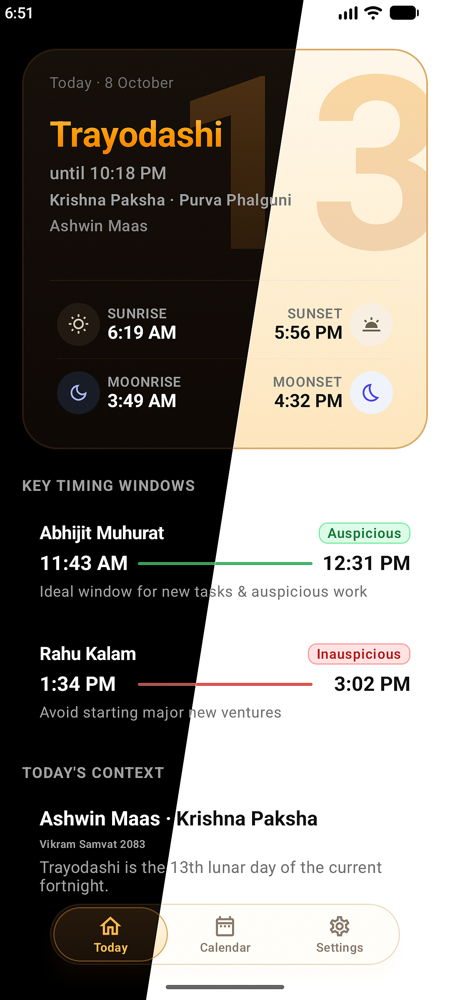
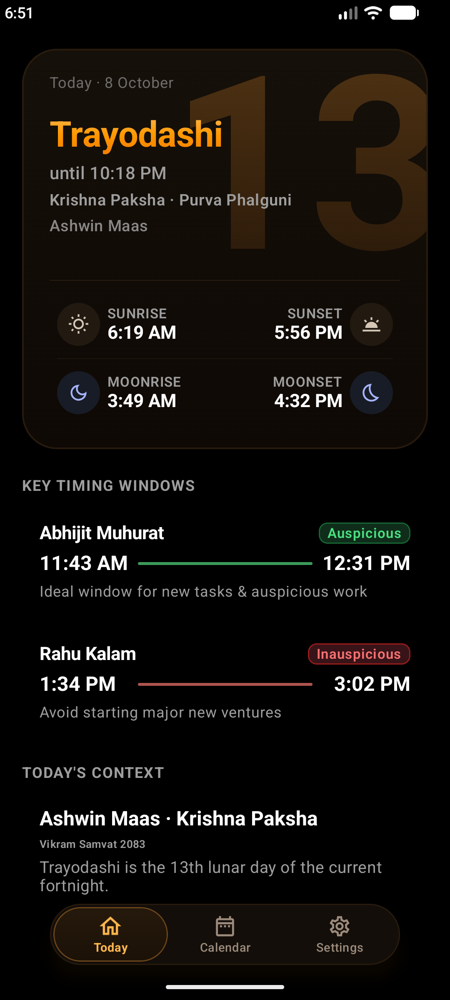
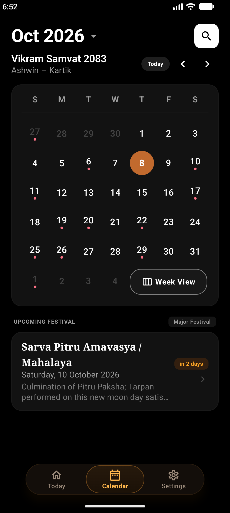
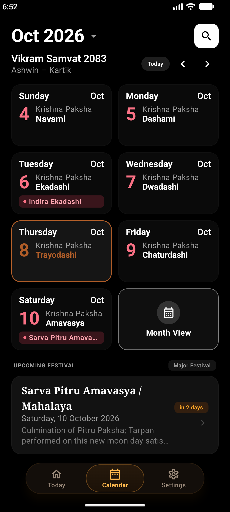
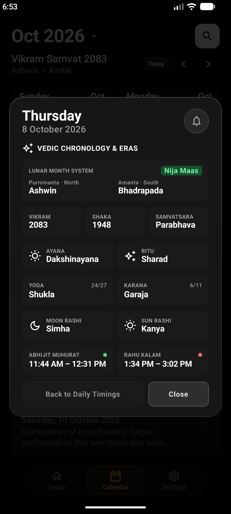
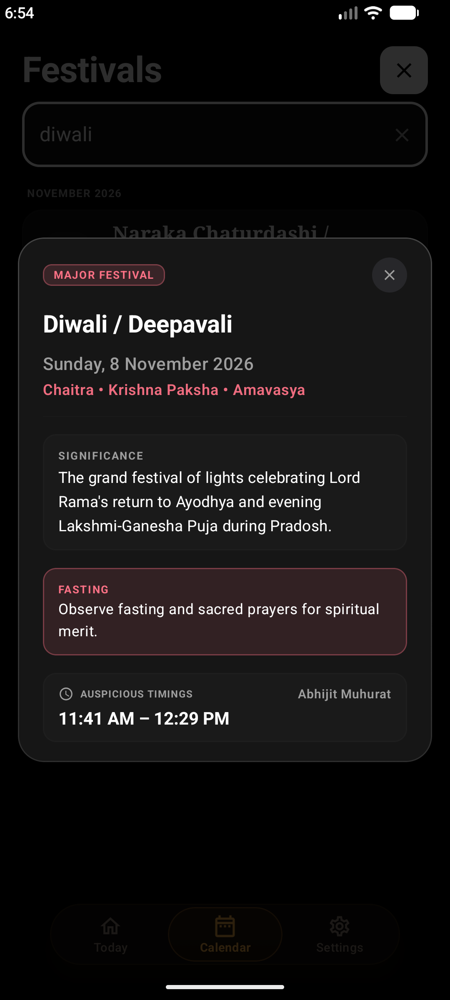
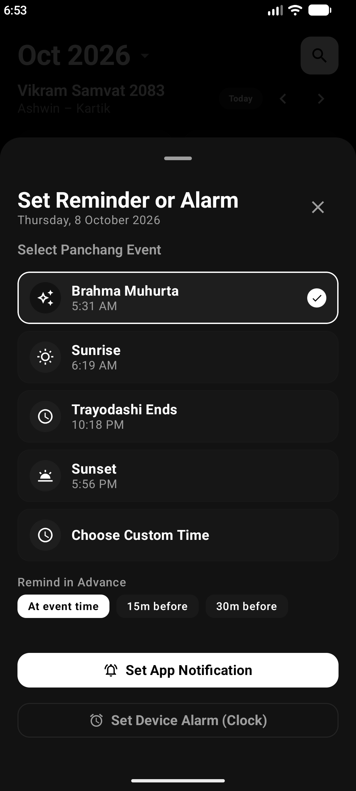
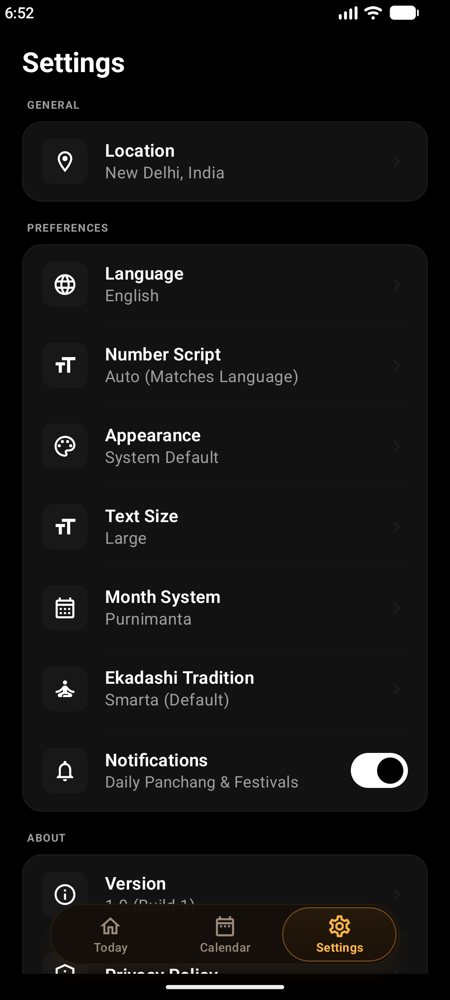
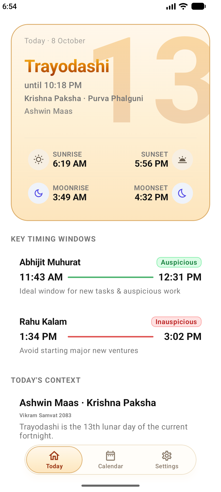

<div align="center">


# Tithi

**A Fast, Elegant, Privacy-Focused, Offline-First Hindu Calendar & Panchang for Android**

[](release/)
[](https://play.google.com/store/apps/details?id=com.sudhnsh.tithi)
[](https://github.com/sudhnsh/Tithi-App/issues)

<p align="center">
  <a href="https://play.google.com/store/apps/details?id=com.sudhnsh.tithi"><b>Install from Google Play</b></a> •
  <a href="#-play-vs-nonplay-flavors">Play vs NonPlay</a> •
  <a href="#-visual-showcase">Screenshots</a> •
  <a href="#-features">Features</a> •
  <a href="#-reporting-issues--feedback">Raise an Issue</a> •
  <a href="#-installation-guide">Installation</a>
</p>

</div>

---

## 📖 Overview

**Tithi** is a modern Hindu calendar, Panchang, and festival companion built strictly with Jetpack Compose and Material 3 design principles. Combining spiritual depth with a minimal, dark-first glassmorphic interface, Tithi runs all astronomical, Tithi, Nakshatra, Muhurat, and festival calculations directly on your device.

- **Zero Tracking & Zero Ads**: Your spiritual practices and location remain 100% private.
- **Offline-First Calculation Engine**: Fully functional without an internet connection.
- **Dual Flavor Architecture**: Optimized builds for both standard devices (`play`) and standalone/de-Googled distributions (`nonPlay`).

---

## 📦 Downloads & Releases (v1.1.0)

<div align="center">

[](https://play.google.com/store/apps/details?id=com.sudhnsh.tithi)

</div>

Directly install via the **[Google Play Store](https://play.google.com/store/apps/details?id=com.sudhnsh.tithi)** or download pre-compiled release APKs from the [`release/`](release/) directory:

| Flavor / Channel | Type | File Size | Recommended For | Link / SHA-256 Checksum |
| :--- | :--- | :--- | :--- | :--- |
| **Google Play** | Play Store App | Dynamic | Standard Android devices with Google Play Services | [**Get on Google Play**](https://play.google.com/store/apps/details?id=com.sudhnsh.tithi) |
| [**`app-nonPlay-release.apk`**](release/app-nonPlay-release.apk) | Standalone APK | **~6.57 MB** (6.88 MB disk) | **Direct sideloading, F-Droid, GrapheneOS, CalyxOS, LineageOS, de-Googled devices** (Bundled offline fonts, zero Google dependencies) | `5b9b8f17c60aa35bb340ecc0aa5e97f3bd355e255610e8144f2f7958e556edd9` |
| [**`app-play-release.apk`**](release/app-play-release.apk) | Direct APK | **~5.92 MB** (6.21 MB disk) | Devices with Google Play Services installed (Uses Google Downloadable Fonts) | `af84856711d233af14fe64c2704b91111c91a39e3369ca708350dfc96e4b233b` |

---

## ⚖️ `play` vs `nonPlay` Flavors

Tithi is distributed in two distinct flavors to give users complete control over dependencies, privacy, and storage:

```
                      ┌────────────────────────────────────────┐
                      │            Tithi Codebase              │
                      │       (Pure Kotlin Vedic Engine)       │
                      └───────────────────┬────────────────────┘
                                          │
                  ┌───────────────────────┴───────────────────────┐
                  ▼                                               ▼
      ┌────────────────────────┐                     ┌────────────────────────┐
      │      play Flavor       │                     │     nonPlay Flavor     │
      ├────────────────────────┤                     ├────────────────────────┤
      │ • Google Play target   │                     │ • F-Droid / Sideload   │
      │ • Google Fonts API     │                     │ • 100% Offline Fonts   │
      │ • FusedLocationClient  │                     │ • Android Native GPS   │
      │ • Size: ~5.92 MB       │                     │ • Size: ~6.57 MB       │
      │ • com.sudhnsh.tithi    │                     │ • .tithi.nonplay       │
      └────────────────────────┘                     └────────────────────────┘
```

### Detailed Comparison Matrix

| Architectural Dimension | `play` Flavor | `nonPlay` Flavor (Recommended for Sideloading) |
| :--- | :--- | :--- |
| **Primary Target** | [Google Play Store](https://play.google.com/store/apps/details?id=com.sudhnsh.tithi) & devices with Google Play Services | GitHub Releases, F-Droid, de-Googled ROMs (GrapheneOS, CalyxOS, LineageOS) |
| **Google Play Services Dependency** | Uses Google Play Services for downloadable fonts and location provider | **Zero Google Play Services dependency**; 100% autonomous |
| **Typography & Fonts** | Uses `GoogleFont.Provider` targeting `com.google.android.gms.fonts` (downloaded on demand to minimize APK footprint) | **Bundled offline `.ttf` fonts** directly in APK assets (`res/font/`); instant rendering with zero network access |
| **Bundled Font Licensing** | Downloaded via Google Fonts API | Licensed under **SIL Open Font License (OFL) v1.1** (100% royalty-free for commercial & offline embedding) |
| **Included Font Families** | Resolved dynamically | `Playfair Display`, `Cinzel`, `Outfit`, `Lora`, `Rozha One`, `Martel` + Native OS Serif for Indic scripts |
| **Location Acquisition** | `FusedLocationProviderClient` with native GPS fallback | Native Android `LocationManager` (`GPS_PROVIDER`, `NETWORK_PROVIDER`, `PASSIVE_PROVIDER`, or API 30+ `getCurrentLocation()`) |
| **Manual Location Support** | Available (City picker + manual coordinates) | Available (City picker + manual coordinates) |
| **Application ID** | `com.sudhnsh.tithi` | `com.sudhnsh.tithi.nonplay` *(can be installed side-by-side with the Play version)* |
| **Download APK Size** | **~5.92 MB** | **~6.57 MB** *(+665 KB difference due to bundled TTF font files)* |
| **Network Access Needed** | Only once during font initialization | **Never** — completely air-gapped capable |

---

## 📱 Visual Showcase

<div align="center">
  
</div>

<br/>

### Screen Gallery

| Today & Daily Panchang | Monthly Vedic Calendar | Weekly Agenda View | Vedic Chronology & Eras |
| :---: | :---: | :---: | :---: |
|  |  |  |  |

| Festival Details & Significance | Panchang Alarms & Reminders | Settings & Customization | Muhurats & Timing Windows |
| :---: | :---: | :---: | :---: |
|  |  |  |  |

---

## ✨ Features

### 1. Comprehensive Daily Panchang
- **Five Limbs of Vedic Time**: Exact calculation of **Tithi**, **Nakshatra**, **Yoga**, **Karana**, and **Vaara** (Day).
- **Exact End Times & Transitions**: Shows start time, end time, and percentage elapsed for active Tithis and Nakshatras.
- **Paksha, Maas & Samvat**: Displays Shukla/Krishna Paksha, current Maas (including Adhik Maas detection), Vikram Samvat, and Shaka Samvat.

### 2. High-Precision Solar & Lunar Ephemeris
- **Sun Timings**: Precise astronomical local Sunrise, Sunset, solar Noon (Madhyahna), and daylight duration.
- **Moon Timings**: Moonrise, Moonset, Moon phase, and Moon Rashi (Zodiac sign transition).
- **3-Day Interactive Timeline**: Continuous solar/lunar timeline showing yesterday, today, and tomorrow.

### 3. Auspicious & Inauspicious Muhurats
- **Auspicious Timings**: Abhijit Muhurat, Brahma Muhurat, Amrit Kalam, Godhuli Muhurat.
- **Inauspicious Timings**: Rahu Kalam, Yamaganda, Gulika Kalam, Dur Muhurat, Varjyam.
- **Active Status Indicator**: Live banner showing whether an auspicious or inauspicious period is currently in effect.

### 4. Festivals, Vratas & Observances
- **Multi-Year Hindu Festivals**: Complete festival calendar covering 2020 through 2034.
- **Vrata Calculations**: Ekadashi (with Parana timings), Pradosham, Sankranti, Purnima, Amavasya, Shivaratri, Navratri, and more.
- **Spiritual Significance**: Curated spiritual context, rituals, and deity associations for major festivals.

### 5. Regional Traditions & Customization
- **Month Calculation Tradition**: Switch between **Purnimanta** (North Indian) and **Amanta** (South/West Indian) lunar month traditions.
- **Ekadashi Calculation Rule**: Support for **Smartha** and **Vaishnava** rules.
- **Indic Script Numerals**: Display calendar and Panchang digits in Western Arabic, Devanagari, Gujarati, Tamil, Telugu, Kannada, Bengali, Malayalam, or Odia numerals.
- **Location Flexibility**: Auto-detect location via GPS/Network, choose from a built-in offline database of Indian and international cities, or enter custom latitude/longitude coordinates.

### 6. Glance AppWidget
- **Home Screen Widget**: Glance-powered Material 3 widget displaying today's Tithi, Sunrise, Sunset, and upcoming festival directly on your launcher.

---

## 🐛 Reporting Issues & Feedback

All issues, bug reports, festival calculation audits, and feature requests should be reported directly on GitHub:

👉 **[Raise an Issue on GitHub](https://github.com/sudhnsh/Tithi-App/issues)**

When creating an issue, please specify:
1. **App Flavor**: (`nonPlay` or `play`)
2. **Device & OS Version**: (e.g., Pixel 7 / Android 14, Redmi Note / Android 11)
3. **Location**: (e.g., Delhi, Bengaluru, or custom coordinates)
4. **Discrepancy Details**: Specific date, Tithi, Karana, or Muhurat timing observed vs. expected.

---

## 🛠️ Technology Stack & Architecture

- **Language**: 100% Kotlin
- **UI Toolkit**: Jetpack Compose, Material 3, custom glassmorphism shaders & draw modifiers
- **Architecture**: MVVM + Clean Architecture with unidirectional data flow (UDF)
- **Async & State**: Kotlin Coroutines & `StateFlow`
- **Preferences**: Jetpack DataStore Preferences
- **AppWidget**: AndroidX Glance Material 3
- **Engine**: Pure Kotlin astronomical math (zero external calculation web APIs required)

---

## 📲 Installation Guide

### Sideloading the APK

1. Download [`app-nonPlay-release.apk`](release/app-nonPlay-release.apk) on your Android device.
2. Open the downloaded `.apk` file using your device's file manager or browser.
3. If prompted, enable **"Allow installation from this source"** in your Android Settings.
4. Tap **Install** and launch Tithi.

### Verifying File Integrity

You can verify the authenticity and integrity of the downloaded APK using `sha256sum`:

```bash
# On Linux / macOS:
shasum -a 256 app-nonPlay-release.apk

# Expected output:
# 5b9b8f17c60aa35bb340ecc0aa5e97f3bd355e255610e8144f2f7958e556edd9  app-nonPlay-release.apk
```

```powershell
# On Windows PowerShell:
Get-FileHash app-nonPlay-release.apk -Algorithm SHA256
```

---

## 🔒 Privacy & Offline Guarantee

- **No Analytics / No Crashlytics**: Tithi contains no tracking SDKs or telemetry.
- **No Ads**: Clean, respectful user interface without commercial distraction.
- **Air-Gapped Operation**: Once installed, Tithi can compute Panchang and festival dates for any year without an active internet connection.
- **Location Privacy**: Location data never leaves your device. It is used exclusively to compute astronomical angles and sunrise/sunset timings locally.

---

## 📄 License & Typography Credits

- **Application Code**: Licensed under the [Apache License, Version 2.0](https://www.apache.org/licenses/LICENSE-2.0).
- **Bundled Fonts**: Distributed under the **SIL Open Font License (OFL) v1.1**:
  - *Playfair Display*, *Cinzel*, *Outfit*, *Lora*, *Rozha One*, *Martel*.
  - Licensed for 100% royalty-free commercial, non-commercial, and offline software embedding.
